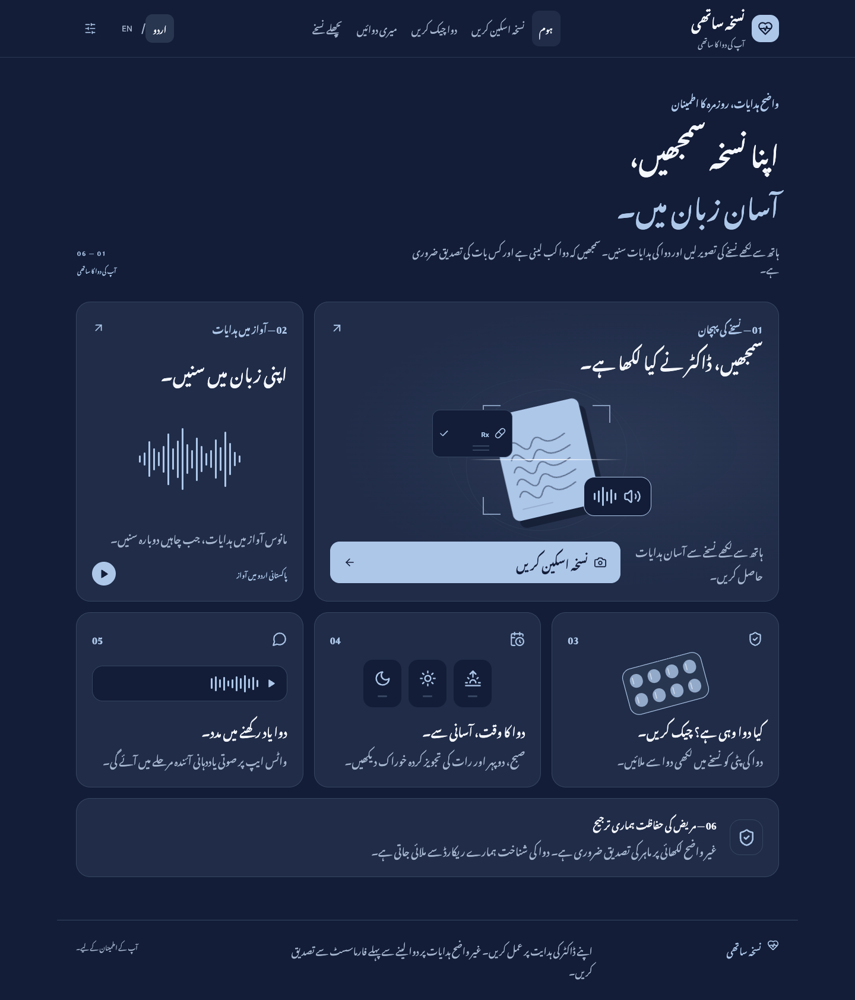
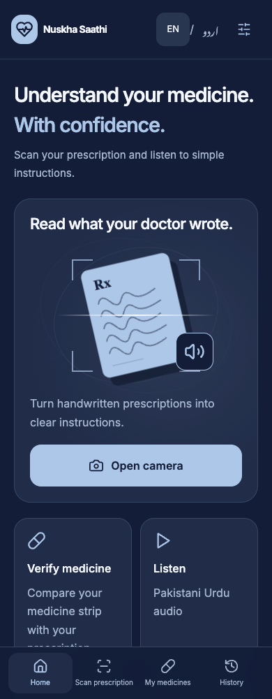

# Nuskha Saathi (نسخہ ساتھی)

A bilingual prescription companion for Pakistani patients. Photograph a handwritten prescription, compare the source with the extracted information, check medicine identity, and replay Urdu instructions.

Vision reads the photograph. The deterministic safety engine resolves medicines and checks instructions. Uncertain names and doses require professional confirmation.

## Live Deployment

- **Frontend (Next.js 16 on Vercel):** https://nuskha-saathi-rose.vercel.app
- **Safety Engine API (FastAPI on Vercel):** https://nuskha-saathi-api.vercel.app
- **Quick Demo Mode:** Add `?demo=offline` (https://nuskha-saathi-rose.vercel.app/?demo=offline), click **Try 5 demo cases** inside **Scan prescription**, or triple-tap the **Nuskha Saathi** logo in the header.

## Redesigned & Completed Experience

- **Pill-Portal Hero & Optical Filter:** Opening capsule aperture built with a hardware-accelerated WebGL glass refraction filter (`OpticalPrismFilter`), Midnight Navy (`#131D38`), Powder Blue (`#ADC7E9`), Warm Porcelain / High-Contrast Light & Midnight themes, and Rx Shield icons (`/icon.svg`, `/apple-icon.png`).
- **Pakistani Urdu Readability:** Full English (`LTR`) and Pakistani Urdu (`RTL`) interfaces using `Noto Naskh Arabic` alongside `Noto Nastaliq Urdu` fallbacks with generous line-height (`2.15–2.35`), clean zero-overlap spacing, and 48px primary touch targets across desktop and mobile (`390px+`).
- **Prescription Camera & Refusal Pipeline:** Live camera, capture/retake/review, gallery upload, camera permission handling, optional device torch, JPEG/PNG/WebP checks up to 8 MB, and EXIF-safe cropping on unreadable lines (`REFUSED_BLURRY`, `REFUSED_UNKNOWN_DRUG`, `REFUSED_DOSAGE_ANOMALY`).
- **Cross-Doctor Active Cabinet Sync:** Manage active ongoing medicines in **My medicines** (including 1-click *Seed Marevan 5mg* for the Amma Zubaida cross-doctor scenario), stored locally and synced with backend `/api/v1/cabinet/{patient_id}` so new scans check interactions against prior clinics automatically.
- **5-Case Clinical Demo & Offline Stage Suite:** Sample Pakistani clinical test cases covering cross-doctor Ibuprofen+Warfarin bleed risk, Sildenafil+Ismo nitrate emergency, 5000mg Leflox overdose refusal, unknown brand refusal, and all-clear typo resolution (`Augmntin` -> `Augmentin`), with automatic offline fallback when `?demo=offline` is set.
- **Visual Dosage Cards & Medicine Strip Verifier:** Distinguishes confirmed doses, explicit zeros (`0`), and unknown doses (`?`), individual printing, QR audio replay (`/audio/[scanId]`), WhatsApp composer share, Day-3 antibiotic WhatsApp preview & webhook simulation modal, and all 5 strip verification outcomes with explicit generic substitution caution.
- **Opt-In Developer Proof & Safety Benchmark:** Opt-in Settings toggle revealing returned latency timings, estimated request cost (USD/PKR), RapidFuzz scores, raw openFDA excerpts, and the live **30-Case Safety Benchmark** report from `/api/v1/benchmark`.

### Screenshots

These are actual screenshots of the production build. Homepages contain no fabricated patient records.

| English desktop | Urdu desktop |
| --- | --- |
|  |  |

| English mobile | Urdu mobile |
| --- | --- |
|  |  |

## Backend and API contracts

FastAPI endpoints in `main.py`:

| Endpoint | Purpose |
| --- | --- |
| `POST /api/v1/scan-parchi` | Prescription extraction (Gemini Vision), deterministic medicine resolution, overdose/interaction checks, Urdu script/audio, telemetry |
| `POST /api/v1/verify-strip` | Compare photographed blister strip against selected prescription medicine & strength |
| `GET /api/v1/audio/{scan_id}` | Retrieve saved Urdu script and audio location for QR replay (supports cold-lambda recovery for demo scans) |
| `GET /api/v1/cabinet/{patient_id}` | Retrieve saved cross-doctor Active Cabinet medicines |
| `POST /api/v1/cabinet/{patient_id}` | Add medicine to Active Cabinet with automatic generic salt resolution |
| `DELETE /api/v1/cabinet/{patient_id}/{item_id}` | Remove a medicine from Active Cabinet |
| `GET /api/v1/demo-cases` | List the 5 sample Pakistani clinical demo cases |
| `POST /api/v1/demo-cases/{case_id}` | Run a deterministic clinical demo case through the safety engine |
| `POST /api/v1/whatsapp/send-reminder` | Preview Day-3 antibiotic Urdu prompt (`whatsapp_scheduled=false` unless Twilio/Meta configured) |
| `POST /api/v1/whatsapp/webhook` | Classify patient WhatsApp replies (`1` Continuing vs `2` Stopped/Side-effect escalation) |
| `DELETE /api/v1/cabinet/{patient_id}` | One-tap clear of every active cabinet medicine for the patient |
| `GET /api/v1/benchmark` | Return results from the 30-case deterministic safety harness (`tests/eval_results.json`) |
| `GET /health` | Service readiness, capability flags, formulary size (`327` brands, `73` interaction pairs), and store counts |

### Disclosed models, datasets & libraries

- **Vision extraction (perception only):** Google Gemini (`GEMINI_API_KEY`) extracts line text, confidence, and bounding coordinates; it never makes clinical safety decisions.
- **Deterministic safety gate & datasets:** RapidFuzz brand normalization (`cutoff=82`), compiled Pakistani DRAP brand/salt formulary (`327` entries) with WHO AWaRe classifications and daily max dose ceilings, openFDA Drug Label API (`fda.gov`) plus cached verified label excerpts (`73` interaction pairs). Neither FDA nor WHO endorses this application.
- **Frameworks & infrastructure:** FastAPI, Pydantic, Pillow, httpx, Next.js 16, React, Lucide Icons, custom WebGL GLSL shader Hero (`THREE`-free lightweight procedural WebGL canvas), SQLite runtime persistence + Postgres schema in [`backend/sql/supabase_schema.sql`](backend/sql/supabase_schema.sql), Playwright, `@axe-core/playwright`.
- **Voice & messaging order:** Server Urdu audio order is Uplift Orator → Azure Speech → Google TTS (falls back to browser Urdu speech synthesis when TTS keys are unset; never substitutes English voice for Urdu clinical guidance). WhatsApp reminders stay explicitly disabled (`whatsapp_scheduled: false`) until real Twilio/Meta credentials are connected.

## Run locally

From this directory:

```bash
cp .env.example .env
cd backend
python3 -m venv .venv
.venv/bin/pip install -r requirements.txt
.venv/bin/python -m uvicorn main:app --reload
```

Set `GEMINI_API_KEY` in `.env`. Configure `UPLIFT_API_KEY` and `UPLIFT_VOICE_ID` for Pakistani Urdu MP3. Azure and Google keys are optional fallbacks. Never put these credentials in frontend variables. The backend loads this directory's `.env` or `backend/.env`.

In another terminal:

```bash
cd frontend
cp .env.example .env.local
npm ci
npm run dev
```

Open `http://localhost:3000`; FastAPI runs at `http://localhost:8000`. Camera capture requires localhost or HTTPS. On Windows, use `.venv\Scripts\` instead of `.venv/bin/`.

## Verification

```bash
cd backend
.venv/bin/python -m pytest -q
```

With the frontend running, execute in `frontend/`:

```bash
npm run typecheck
npm run test:ui
npm run build
npm audit --omit=dev
```

The UI suite uses installed Google Chrome by default. Set `UI_TEST_BROWSER=chromium` after `npx playwright install chromium` to use Playwright's browser. `UI_TEST_BASE_URL` changes the origin; `UI_TEST_OUTPUT` changes the artifact directory (default `/tmp/nuskha-ui-results`). The browser suite intercepts API requests with explicit test fixtures; the application never imports those fixtures. It exercises real browser media playback, simulated camera capture, safety/verification states, and accessibility checks.

The old `next lint` command was removed because this Next.js version does not support it and the repository has no ESLint configuration. TypeScript and browser checks are available through the scripts above.

[Verification results, tested limits, and milestone commits](../docs/ui-redesign/verification.md) · [Machine-readable browser report](../docs/ui-redesign/browser-report.json)

## Deployment

### Render backend

The Render API is available at [nuskha-saathi-api.onrender.com](https://nuskha-saathi-api.onrender.com). Use [`/docs`](https://nuskha-saathi-api.onrender.com/docs) to explore the API and [`/health`](https://nuskha-saathi-api.onrender.com/health) to check readiness and capability flags. The root `/` has no homepage.

- Repository branch: `main`; root directory: `nuskha-saathi/backend`.
- Runtime: Docker; Dockerfile: `Dockerfile`; port: `8000`; health check: `/health`.
- Configure `GEMINI_API_KEY` as a Render environment variable, with `GEMINI_MODEL=gemini-2.5-flash`. Set `FRONTEND_BASE_URL` to the intended frontend origin for audio replay links. Keep API keys out of Git and frontend variables.
- Auto-deploy watches changes within the backend root directory. For a manual release, choose **Manual Deploy → Deploy latest commit**, then verify the deployed commit and `/health`. `vision_configured: true` confirms a key is present; a successful live scan is needed to verify Gemini access.
- Free instances sleep after inactivity. Warm `/health` before a demo. SQLite records, generated audio, and strip thumbnails on the instance disk can be lost on redeploy or restart; durable storage requires separate configuration.

### Private Render diagnostics

Open [the backend panel](https://nuskha-saathi-api.onrender.com/admin). In Render → backend → Environment, add `ADMIN_MONITOR_PASSWORD` with a unique password of at least 16 characters, then save and deploy. Never commit this password or place it in a frontend variable. Until it is configured, login is disabled and diagnostics remain private.

The panel refreshes every 10 seconds while visible and shows application health, Render's `RENDER_GIT_COMMIT`, process uptime, configuration flags, active stages, and the latest 100 API requests. Expand a request for stage timings and sanitized error categories (for example `HTTP_403`). The `X-Request-ID` response header correlates requests with sanitized failure entries in Render logs. Gemini, interaction checks, Urdu audio, and persistence are traced when executed; skipped/unavailable stages and clinical outcomes are separate from technical failures. Configuration flags alone do not prove a provider works.

Sessions expire after 8 hours, restart, or a password change. Five failed logins block that client for five minutes. Diagnostics and login limits are bounded and local to one process, reset on restart, and do not aggregate across instances. They retain no patient bodies, images, query strings, raw error messages, or API keys. Existing application storage and Render's own access logs are separate. Pause or close the panel to stop polling; polling can keep a free Render service awake. The browser marks data stale if it cannot reach the backend, but this is not an independent uptime or Render infrastructure monitor. Use the Render logs link for platform deployment/runtime logs.

### Vercel deployments

- **Frontend project on Vercel (`nuskha-saathi`):** Root directory `nuskha-saathi/frontend` with production env `NEXT_PUBLIC_API_BASE_URL=https://nuskha-saathi-api.vercel.app`.
- **Backend project on Vercel (`nuskha-saathi-api`):** Root directory `nuskha-saathi/backend` using Vercel native FastAPI support (`main.py` + `requirements.txt`) and `GEMINI_API_KEY` secret configured server-side. Alternatively, `backend/Dockerfile` runs on port `8000` with persistent volumes for `/app/static` and SQLite/Supabase Postgres (`backend/sql/supabase_schema.sql`).
- Both production URLs were verified live (`200 OK`): all 5 unmocked interactive E2E flows, live Gemini Vision `POST /api/v1/scan-parchi`, QR cold recovery (`/audio/scan_de0000000000000000000001`), and all 19 Playwright WCAG 2.2 AA & UI checks passed against `https://nuskha-saathi-rose.vercel.app`.

## Verified Test Coverage & Honest Limits

- **Backend tests (`pytest`):** `30 passed` covering formulary matching, confidence lock (`<0.75` refusal), overdose ceiling blocking (`5000mg` Leflox), openFDA salt-only queries, cabinet CRUD + auto-merge, WhatsApp honest unconfigured/webhook checks, serverless `/tmp` storage, and demo QR cold recovery.
- **Deterministic 30-Case Safety Benchmark (`python -m tests.run_eval_30`):** `30/30 passed` (`p50=0.068ms` deterministic engine latency across 15 Pakistani brand extractions, 5 illegible/low-confidence refusals, 5 high-risk interactions, and 5 strip swaps/overdose ceilings). *Note: This harness measures the deterministic clinical engine offline (non-VLM latency); real-world prescription photos add Gemini Vision inference latency and still require pharmacist/clinician validation.*
- **Frontend checks:** `tsc --noEmit` clean, `next build` clean, `19/19` Playwright + axe-core WCAG 2.0/2.1/2.2 AA checks passing locally and against `https://nuskha-saathi-rose.vercel.app`.
- **Honest Limits:** Outbound WhatsApp reminder scheduling remains explicitly disabled (`Enable reminders` disabled; `whatsapp_scheduled: false`) until real Twilio/Meta credentials are supplied. On Vercel serverless, `/tmp` SQLite storage is ephemeral per instance, while browser `localStorage` persists saved scans (`<= 20`) and cabinet items locally on device. Live handwriting accuracy across diverse clinicians, Uplift/Azure/Google audio quality when credentials are supplied, physical smartphone cameras/torch, and regional languages need device/credential-backed acceptance testing.

Follow the treating clinician's instructions. Ask a pharmacist to confirm unclear wording before taking medicine. The app does not diagnose, prescribe, or authorize changing medicines.
