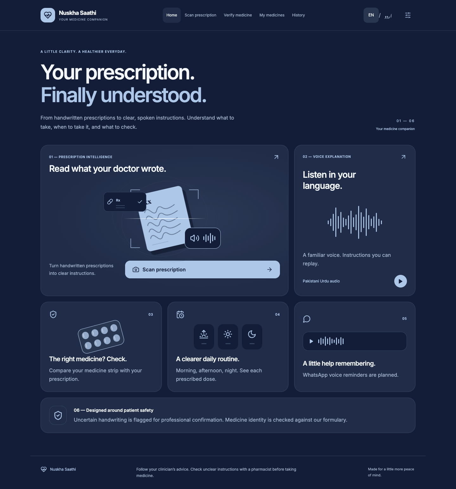
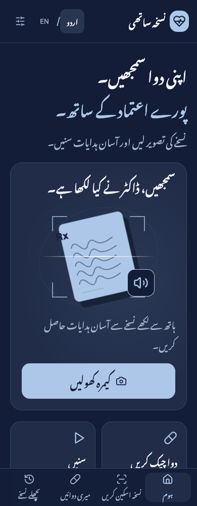

# Nuskha Saathi — نسخہ ساتھی

A bilingual prescription companion for Pakistani patients. Photograph a handwritten prescription, compare the source with the extracted information, check medicine identity, and replay Urdu instructions.

Vision reads the photograph. The deterministic safety engine resolves medicines and checks instructions. Uncertain names and doses require professional confirmation.

## Redesigned experience

- Midnight Navy (`#131D38`), Powder Blue (`#ADC7E9`), and Ice White (`#F4F7FC`) design tokens, custom SVG medical illustrations, desktop bento layout, and a mobile scanning experience.
- Persistent English/LTR and Urdu/RTL interfaces with Inter and Noto Nastaliq Urdu. Settings also offer a high contrast light theme.
- Live camera, capture/retake/review, gallery upload, camera permission handling, optional device torch, file checks, and advisory low-light detection. Accepted images: JPEG, PNG, WebP, up to 8 MB.
- Honest indeterminate processing: the API supplies one final response, so the UI does not invent step completions or percentages.
- Original prescription comparison, original OCR wording, confirmed medicine information, refusal crops, and prominent interaction warnings. HIGH interactions appear red; MODERATE interactions and uncertain lines appear amber.
- Visual dosage cards distinguish a confirmed dose, an explicit zero, and an unknown dose. Meal timing and duration come from the backend. Cards support individual printing, audio QR replay, and sharing the replay link in a WhatsApp composer.
- Medicine strip capture and all five API outcomes, including a caution that a generic match does not authorize substitution. Thumbnails appear only for a confirmed match.
- Urdu audio with play/pause, real progress and duration, replay, speed selection, and playback-driven decorative waveforms. QR links preserve `/audio/[scanId]`.
- Explicit saving of up to 20 prescriptions in this browser, a medicine cabinet, history replay, and deletion. Original full-size photos are kept only in the current scan session.
- Developer Proof is hidden until enabled in Settings for the current session. It shows returned timings, costs, fuzzy scores, and raw interaction evidence. Provider/fallback selection is not reported by the current API.
- Native modal dialogs, keyboard focus styles, 48px primary touch targets, offline messaging, reduced motion, bilingual empty/error states, and install metadata/icons.

### Screenshots

These are actual screenshots of the production build. Homepages contain no fabricated patient records.

| English desktop | Urdu desktop |
| --- | --- |
|  |  |

| English mobile | Urdu mobile |
| --- | --- |
|  |  |

## Backend and API contracts

The redesign preserves the FastAPI endpoints and clinical logic:

| Endpoint | Purpose |
| --- | --- |
| `POST /api/v1/scan-parchi` | Prescription extraction, deterministic medicine resolution, safety checks, Urdu script/audio, telemetry |
| `POST /api/v1/verify-strip` | Compare the photographed strip with the selected prescription line |
| `GET /api/v1/audio/{scan_id}` | Retrieve the saved script and clip location for QR replay |
| `GET /health` | Service readiness and loaded dataset counts |

The backend uses Gemini Vision, RapidFuzz, the curated Pakistani formulary, openFDA, and cached interaction evidence. WHO AWaRe labels are preserved. Neither FDA nor WHO endorses this application. Dose ceilings detect impossible OCR values; they are not personalized prescribing advice.

The Urdu server voice order remains Uplift Orator → Azure → Google. If a clip is unavailable, the patient can request an installed Urdu browser voice. The UI refuses to substitute an English voice for missing Urdu speech. English clinical audio and regional audio are not enabled. Browser camera guidance can use a matching installed English or Urdu voice.

## Run locally

From this directory:

```bash
cp .env.example .env
cd backend
python3 -m venv .venv
.venv/bin/pip install -r requirements.txt
.venv/bin/python -m uvicorn main:app --reload
```

Set `GEMINI_API_KEY` in `.env`. Configure `UPLIFT_API_KEY` and `UPLIFT_VOICE_ID` for Pakistani Urdu MP3. Azure and Google keys are optional fallbacks. Never put these credentials in frontend variables. The backend loads this directory's `.env` or `backend/.env`.

In another terminal:

```bash
cd frontend
cp .env.example .env.local
npm ci
npm run dev
```

Open `http://localhost:3000`; FastAPI runs at `http://localhost:8000`. Camera capture requires localhost or HTTPS. On Windows, use `.venv\Scripts\` instead of `.venv/bin/`.

## Verification

```bash
cd backend
.venv/bin/python -m pytest -q
```

With the frontend running, execute in `frontend/`:

```bash
npm run typecheck
npm run test:ui
npm run build
npm audit --omit=dev
```

The UI suite uses installed Google Chrome by default. Set `UI_TEST_BROWSER=chromium` after `npx playwright install chromium` to use Playwright's browser. `UI_TEST_BASE_URL` changes the origin; `UI_TEST_OUTPUT` changes the artifact directory (default `/tmp/nuskha-ui-results`). The browser suite intercepts API requests with explicit test fixtures; the application never imports those fixtures. It exercises real browser media playback, simulated camera capture, safety/verification states, and accessibility checks.

The old `next lint` command was removed because this Next.js version does not support it and the repository has no ESLint configuration. TypeScript and browser checks are available through the scripts above.

[Verification results, tested limits, and milestone commits](../docs/ui-redesign/verification.md) · [Machine-readable browser report](../docs/ui-redesign/browser-report.json)

## Deployment

- Vercel project root from the Git repository: `nuskha-saathi/frontend`.
- Frontend build variable: `NEXT_PUBLIC_API_BASE_URL=https://your-backend-origin`.
- Backend variable: `FRONTEND_BASE_URL=https://your-frontend-origin`.
- Deploy `nuskha-saathi/backend` using its Dockerfile on a persistent backend host. The container listens on port 8000. Preserve `/app/static/audio` and `/app/static/strips` so QR replay and verified thumbnails survive restarts.
- Verify backend `/health`, an actual scan, voice generation, strip checking, and a QR replay from the deployed frontend. Camera access requires HTTPS.

No cloud deployment URL was established in this redesign session. Browser-to-FastAPI connectivity was verified locally. Existing API key configuration remains server-side.

## Current limits

- WhatsApp scheduling and server accounts/Supabase are not connected. Reminder controls remain disabled and never claim successful scheduling. Sharing a replay link opens WhatsApp; it does not schedule messages.
- Saved prescriptions are local to this browser, explicitly opt in, and visible to other people using it. They are not encrypted account storage or cross-device sync. Delete them from History.
- Course start/end dates are not returned, so the cabinet cannot determine active/completed courses or calculate upcoming clock times. It shows the confirmed source instructions.
- QR audio links grant access to the saved Urdu explanation to anyone holding the link. Share them deliberately. Backend files require a production retention/access policy and persistent storage.
- Live clinical handwriting accuracy, Urdu voice quality, physical mobile cameras/torch, OS installation, and public deployment connectivity still need device and credential-backed acceptance testing. Automated tests do not certify those.
- Regional audio is queued pending native clinical validation.

Follow the treating clinician's instructions. Ask a pharmacist to confirm unclear wording before taking medicine. The app does not diagnose, prescribe, or authorize changing medicines.
